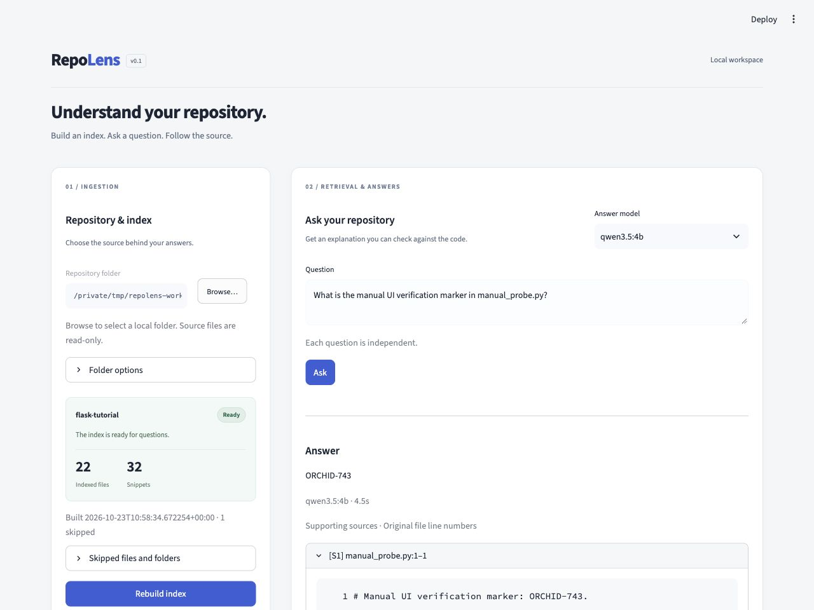
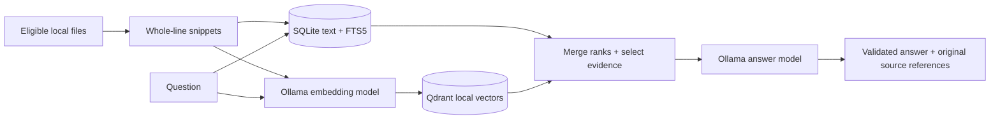

# RepoLens

Ask independent questions about a local repository and inspect the original source snippets behind an answer. RepoLens combines lexical search (SQLite FTS5/BM25) and semantic search (Ollama embeddings + Qdrant local mode), merges ranks with RRF, and asks a local Ollama model to explain the selected evidence.



The screenshot shows a real local-model answer from a disposable source copy used to test explicit rebuilding. See the [demo and evaluation notes](docs/demo.md).

This is a learning and portfolio project. It retrieves relevant text; it does not resolve imports, prove runtime flows, or guarantee that model explanations are correct. References are validated structurally. You should still read the supporting code.

## Run locally

Use **Python 3.11 or 3.12** and install [Ollama](https://ollama.com/download) separately. Start Ollama and download the defaults:

```sh
ollama pull qwen3.5:4b
ollama pull qwen3-embedding:0.6b
```

From this project's root folder, on macOS/Linux:

```sh
python3 -m venv .venv
source .venv/bin/activate
python -m pip install --only-binary=:all: -r requirements.txt
python -m pip install --no-deps .
python -m streamlit run app.py --server.address 127.0.0.1
```

On Windows PowerShell, no activation or execution-policy change is needed:

```powershell
py -3.11 -m venv .venv
.\.venv\Scripts\python.exe -m pip install --only-binary=:all: -r requirements.txt
.\.venv\Scripts\python.exe -m pip install --no-deps .
.\.venv\Scripts\python.exe -m streamlit run app.py --server.address 127.0.0.1
```

Open the loopback URL printed by Streamlit. In the left repository panel, click **Browse…** and select `examples/flask-tutorial`, then click **Build index**. In the right panel, ask “Which CLI command initializes the database?” Expand the sources and verify their paths and original line ranges. The bundled [public sample](examples/SOURCE.md) is copied unchanged from a pinned Flask revision and is never installed or executed by RepoLens.

The workspace places ingestion beside questions and answers, stacking the panels on narrow screens. **Browse…** opens the desktop folder chooser on the computer running RepoLens; cancelling retains your current selection and answer. macOS uses its native chooser; Windows and Linux use Tkinter in a separate helper process. If no desktop chooser is available, expand **Folder options**, enable **Enter path manually**, and enter the local path. Folder selection does not upload repository files. The chooser is intended for this local, single-user app, not a browser on a different computer. Windows/Linux native dialogs have not yet been manually verified.

The models must fit your available memory. Other installed locally runnable models can be selected if Ollama advertises the required generation or embedding capability. RepoLens does not download or silently substitute models. No database server, Docker, cloud account, or hosted inference subscription is needed.

## Rebuilds and model changes

- Builds create new SQLite/Qdrant snapshots and publish only complete matching pairs. A failed build preserves the previous snapshot; **Retry rebuild** starts over.
- File additions, edits, deletions, renames, and changes to eligible files through ignore rules require explicit rebuilding. Freshness is checked before and after an answer.
- An answer-model change clears the displayed answer and uses the existing index. An embedding-model name or digest change requires rebuilding, even if vector dimensions match.
- Index data and model preferences live in `~/.repolens`. Set `REPOLENS_DATA_DIR` to another folder **outside** the indexed repository; overlapping folders are rejected. Run one app process per data directory.
- Requests are finite: discovery 5 seconds, each embedding batch or answer call 120 seconds. Errors require manual retry.

The default build limits are 500 eligible files, 5 MiB total eligible bytes, 256 KiB/file, and 2,000 snippets. Choose a smaller folder if a total limit is exceeded. Filtering respects nested `.gitignore` files, skips symlinks and common generated/dependency folders, and excludes common credential filenames. This is file filtering, not secret detection; review the repository before indexing it. The portfolio demo uses public source.

## How it works



Both search branches run for each question. Each returns ten results; RRF sums `1 / (60 + rank)` for shared snippet IDs. Up to four whole snippets enter the bounded prompt, with overlapping snippets suppressed. Source IDs belong to the application. Unknown citations, malformed JSON, truncated answers, or stale evidence are rejected. UTF-8 byte budgeting is a conservative heuristic, not an exact model tokenizer.

The core modules under `src/repolens/` can be tested without Streamlit. Start reading `config.py`, then `repository.py` and `chunking.py`; follow `indexing.py`, `retrieval.py`, and `answering.py` for the complete flow. The [architecture guide](docs/architecture.md) explains storage, freshness, retrieval, and the main module responsibilities.

## Verify and evaluate

For development, install `requirements-dev.txt` instead of `requirements.txt`, then use `python -m pip install --no-deps -e .` so local edits are visible.

```sh
python -m pytest -q
python -m pytest -m live_models tests/test_live_models.py -q
python -m repolens.evaluation --root examples/flask-tutorial --questions evaluation/questions.json --output evaluation/results/my-unique-run --corpus-revision ff6fa22f4d961a28567db11430208b964620f511
```

The default tests use fake model responses with real file, SQLite, Qdrant, and UI behavior. The second command explicitly selects real Ollama checks. The evaluator preserves all ten cases, compares three retrieval modes, and leaves answer-quality review to a human. Give each evaluation a new output folder; it refuses to overwrite a run. Keep generated indexes outside this repository. See [evaluation results and demo](docs/demo.md) for measured coverage and limitations.

## Troubleshooting

- **Ollama unavailable:** start Ollama, check `ollama list`, then Refresh models. The endpoint is `http://127.0.0.1:11434`.
- **Selected model unsupported:** verify its Ollama capability metadata, or choose a compatible installed model. Ambiguous metadata is not guessed from the name.
- **Rebuild required:** settle repository edits, select the intended embedding model, then rebuild.
- **Index/lock error:** close other RepoLens processes using the same data folder. Corrupt indexes can be rebuilt without changing source files.
- **FTS5 missing:** use a Python distribution whose SQLite includes FTS5. RepoLens reports this at startup.
- **No evidence fits or model context error:** use a compatible model with more context, or shorten the question. This does not mean the requested behavior is absent from the repository.
- **Invalid answer:** retry and inspect the sources. A model can still cite a valid but irrelevant snippet; structural validation cannot prove factual support.

Runtime dependencies are pinned in platform-aware requirements generated with uv 0.13.5. uv is needed only to regenerate the requirements, not to run the application. macOS/Python 3.11 and the default local models have been exercised locally. The [GitHub Actions workflow](.github/workflows/tests.yml) checks model-independent behavior on macOS, Linux, and Windows with Python 3.11/3.12; check the repository's Actions tab for current results. A passing CI job does not verify desktop folder dialogs or local-model performance on that platform.

## License

RepoLens is licensed under the [MIT License](LICENSE). The bundled Flask tutorial retains its upstream license and attribution; see [sample provenance](examples/SOURCE.md) and [Flask license](examples/LICENSE.flask.txt). Dependency and model licenses remain their respective owners' terms.
