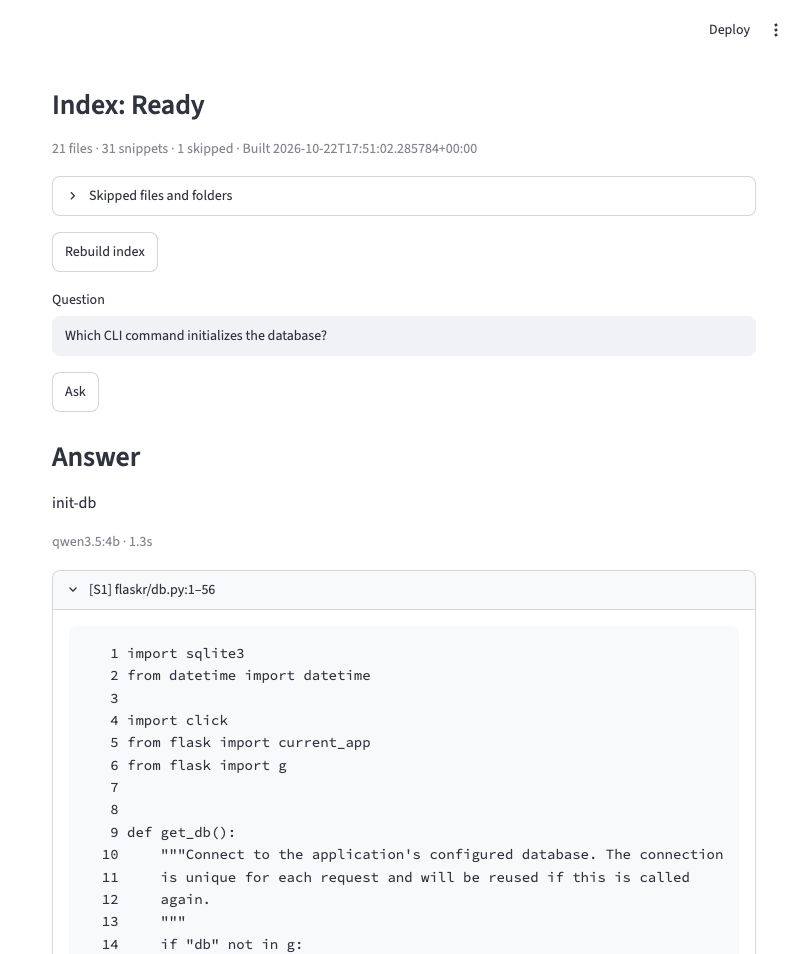

# Demonstration and measured evidence

Run the app locally using the README. Use only the bundled public Flask tutorial for these steps.

1. Click **Browse…**, select `examples/flask-tutorial`, and explicitly build the index. The chooser runs on the computer hosting this local app. Use **Folder options → Enter path manually** if a desktop chooser is unavailable.
2. Ask which CLI command initializes the database. Inspect the original `flaskr/db.py` lines, not just the explanation.
3. Ask for the production login p95 latency. The model should explain that the retrieved source does not establish this runtime measurement.
4. Copy the sample to a separate working directory. Build the copy, edit a source file, and trigger a UI interaction such as **Refresh models** to observe **Rebuild required**. Rebuild and ask again; no background watcher runs.
5. Change the answer model without rebuilding. Change the embedding model and verify that rebuilding becomes necessary.

A local one-screen workflow is the v1 delivery. Hosting, multiuser access, automatic indexing, and repository execution are outside this version.

## Evaluation rubric

The ten fixed questions are in `evaluation/questions.json`. For eight answerable cases, the expected original span must reach the final context and the explanation must be correct with supporting displayed references. For two runtime-only questions, require an explicit evidence limitation and no invented production facts. Manually inspect every returned path and range against the pinned unchanged corpus. The model never grades itself.

The original `2026-10-22-baseline` run is retained, including its citation failure: Q5 answered `@login_required` but cited a neighboring snippet ending at line 60, before the decorator at line 61. A targeted real-model test reproduced the failure. The prompt now requires the exact supporting declaration/decorator rather than a nearby mention; the focused regression passed after that change. Structural citation validation alone could not catch this relevance error.

The [rerun report](../evaluation/results/2026-10-22-citation-prompt/report.json) records the same questions and corpus. Final-context source hits were lexical **5/8**, semantic **8/8**, and hybrid **8/8**. The eight explanations matched their expected facts, and both runtime questions stated an evidence limitation. Codex inspected the cited ranges against the original files; the report labels this explicitly and leaves `human_review` fields open. Q5 now includes the snippet containing lines 60–62, alongside an extra neighboring snippet.

The original [baseline report](../evaluation/results/2026-10-22-baseline/report.json) remains available, including its failed citation check. See its report for full model digests, corpus file hashes, limits, answers, final source ranges, and timings. These are historical runs from October 22, 2026, not a new benchmark for every subsequent code or prompt edit. Source-hit rates on eight questions are a small demonstration, not proof of general superiority or correctness on other repositories.

## Verification coverage

- Actual local model-backed verification uses an Apple Silicon Mac, Python 3.11, `qwen3.5:4b`, and `qwen3-embedding:0.6b`.
- Clean pinned dependency installation, installed-package imports, SQLite FTS5, Qdrant persistence, and `pip check` passed locally. After the two-column UI update, **82 model-independent tests** and both existing live-model tests passed. Coverage includes folder-picker results/cancellation/errors, repository switching, answer/embedding model changes, and failed rebuild retry. The real browser flow verified build → ask → edit a disposable source copy → rebuild required → explicit rebuild → ask again. Desktop and narrow-screen layouts were inspected. The maintainer also exercised the new UI manually; this does not replace the per-question human review fields in the saved evaluation reports.
- Linux, Windows, Python 3.12, and alternate model/hardware combinations were not exercised in the local verification. Consult GitHub Actions for current automated platform checks. Desktop folder dialogs and real-model behavior on Windows/Linux remain unverified; chooser boundary tests do not replace a real desktop selection.
- Model/reference validation checks structure; manually reviewing supporting source remains necessary.

## Review fixes

An independent code review identified four important cases: store substitution with unchanged snippet IDs, corrupt inputs escaping safe errors, Unicode separators shifting physical line references, and unbounded reads after file-size checks. Focused regressions reproduced each before fixes. Completed manifests now bind both stores with SHA-256 file digests; corruption remains rebuildable in the UI; LF/CRLF/CR define source lines; regular files are read with a byte bound. Source gutters also show original numbers. These integrity hashes detect accidental store mismatch, not malicious tampering with both a manifest and its stores.

## Current workspace

This unmodified capture shows the implemented two-column UI. Its source is a disposable copy of the public tutorial with a `manual_probe.py` file containing `# Manual UI verification marker: ORCHID-743.` The marker was changed from `ORCHID-742`, the stale answer was blocked, and an explicit rebuild produced the updated answer with the matching original source line. This extra file is not part of the pinned corpus in `examples/flask-tutorial`.

## Earlier captured walkthrough

[Short demo video](media/repolens-demo.mp4) uses unmodified captures of the earlier single-column UI: ready index, question, supported answer, evidence limitation, stale index, and explicit rebuild. It is a sequence of browser captures, not a continuous screen recording. No generated or fabricated application outcomes are used. The current UI uses the two-column layout above.

